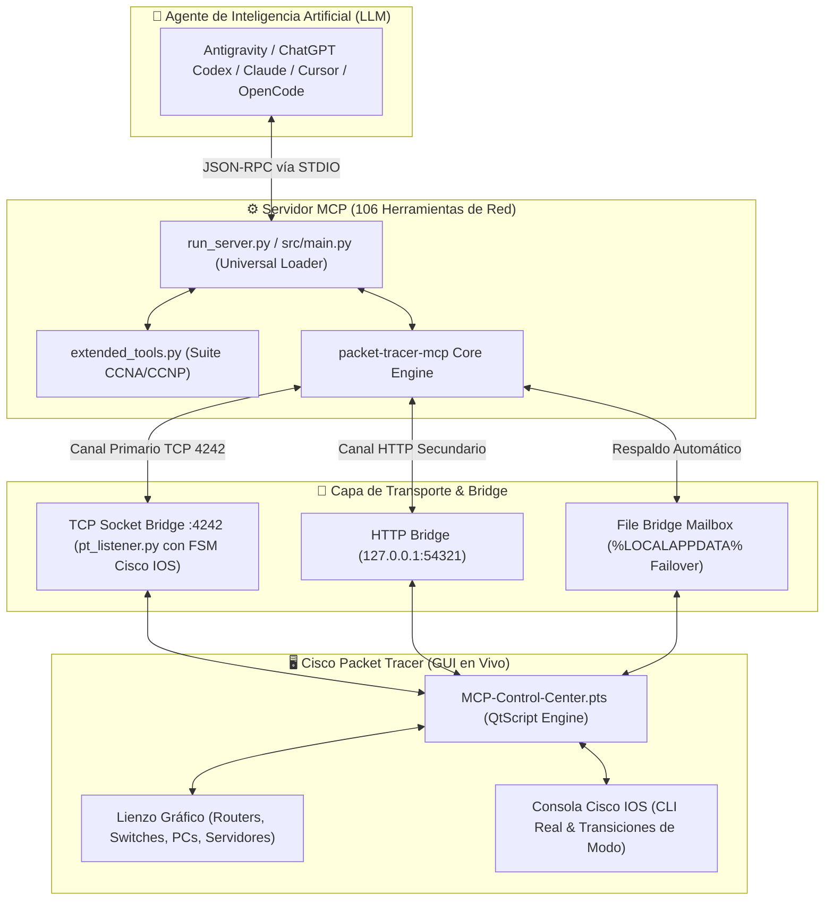
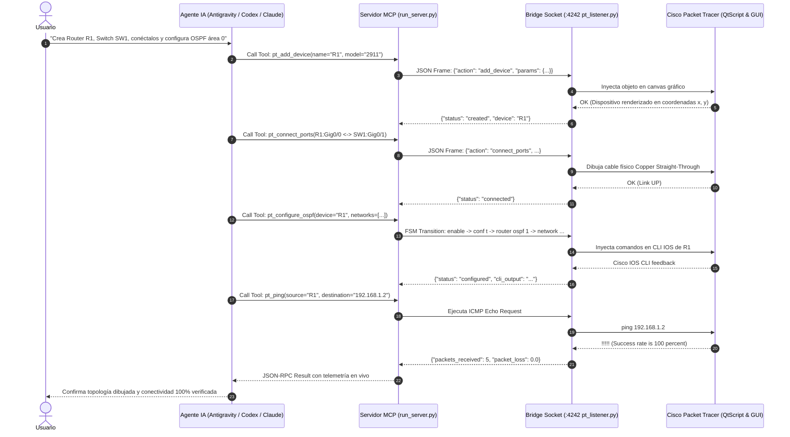
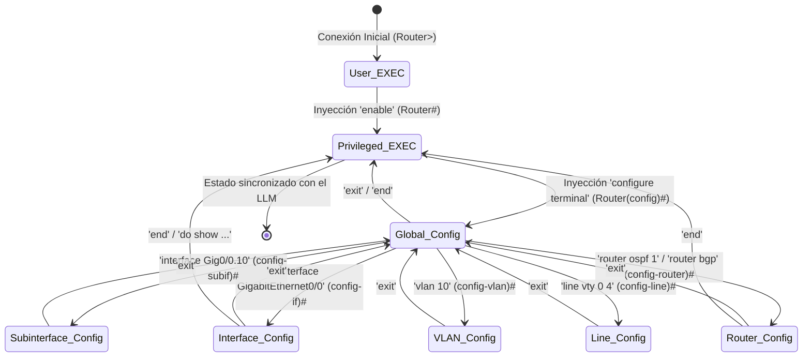

# 🌐 Agent MCP - Cisco Packet Tracer (Real-Time Live Automation)

<div align="left">
  <span style="display:inline-block; border:1px solid #30363d; border-radius:12px; padding:2px 8px; font-size:11px; font-weight:600; color:#58a6ff; background:#0d1117;">Public</span>
  &nbsp;
  <span style="font-size:12px; color:#8b949e;">● <strong>Python</strong> 3.10+ / QtScript</span>
  &nbsp;
  <span style="font-size:12px; color:#8b949e;">⚖️ <strong>MIT License</strong></span>
  &nbsp;
  <span style="font-size:12px; color:#8b949e;">🕒 Actualizado recientemente</span>
</div>

<br/>

[](https://www.python.org/downloads/)
[](https://modelcontextprotocol.io/)
[](https://www.netacad.com/courses/packet-tracer)
[]()
[]()
[](LICENSE)

> ### 🎖️ Autoría y Marca de Agua Oficial
> **Este proyecto fue concebido, diseñado y programado por:**  
> **Ingeniero en Informática Helton Smith Bustos Sáez**  
> *Magíster en Full Stack | Experto en Ciberseguridad e Inteligencia Artificial Aplicada*

---

## 📖 Visión General del Proyecto

**Agent MCP - Cisco Packet Tracer** es una suite de orquestación de redes en tiempo real que dota a cualquier Agente de Inteligencia Artificial (**Antigravity IDE / CLI**, **ChatGPT Codex**, **Claude Code**, **Cursor**, **OpenCode**, **VS Code Copilot**, **Claude Desktop**) de la capacidad de crear, conectar, configurar y diagnosticar topologías completas de red **en vivo y directamente sobre la pantalla de Cisco Packet Tracer**.

A diferencia de los emuladores virtuales en memoria, esta solución se acopla al **Script Engine (QtScript)** original de Cisco Packet Tracer mediante una extensión especializada (`.pts`) y un sistema de transporte dual (**Socket Bridge TCP :4242 / HTTP Bridge :54321** + **File Bridge de alta disponibilidad**).

---

## 🏛️ Diagramas de Flujo y Arquitectura

### 1. Diagrama de Arquitectura Global de Componentes



### 2. Diagrama de Secuencia de Ejecución en Tiempo Real



### 3. Diagrama de la Máquina de Estados Finitos (FSM) de Cisco IOS



---

## 🎛️ Catálogo Maestro de Hardware Soportado (100% Packet Tracer)

### 1. Routers Cisco ISR / Edge
| Modelo | Categoría | Interfaces Nativas | Ranuras de Expansión |
| :--- | :--- | :--- | :--- |
| **Cisco 2911** | Router ISR G2 | 3x GigabitEthernet (0/0, 0/1, 0/2) | 3x HWIC (HWIC-2T para seriales) |
| **Cisco 1941** | Router ISR G2 | 2x GigabitEthernet (0/0, 0/1) | 2x HWIC (HWIC-2T) |
| **Cisco 2901** | Router ISR G2 | 2x GigabitEthernet (0/0, 0/1) | 4x HWIC |
| **Cisco 2811** | Router Clásico | 2x FastEthernet (0/0, 0/1) | 4x WIC, 1x NM (VoIP CME ready) |
| **ISR 4331 / 4321**| Router ISR 4K | 3x GigabitEthernet (0/0/0 a 0/0/2) | Ranuras NIM |
| **Cisco 1841** | Router Modular | 2x FastEthernet | Ranuras WIC |
| **819HG-4G / 829** | Router Industrial | GigabitEthernet + Cellular 4G | IoT / Transporte |
| **CGR1240** | Grid Router | Interfaces industriales IoT | Subestaciones |

### 2. Switches Catalyst Cisco
| Modelo | Tipo | Puertos | Capacidad |
| :--- | :--- | :--- | :--- |
| **Catalyst 2960-24TT** | Capa 2 (L2) | 24x FastEthernet (0/1-24) + 2x GigE (0/1-2) | VLANs, STP, Trunking, Port Security |
| **Catalyst 3560-24PS** | Multicapa (L3) | 24x FastEthernet PoE + 2x GigE SFP | Enrutamiento Inter-VLAN SVI, PoE |
| **Catalyst 3650-24PS** | Multicapa (L3) | 24x GigabitEthernet PoE + 4x SFP+ | Enrutamiento IP Empresarial, OSPF |
| **Catalyst 2950-24** | Capa 2 (L2) | 24x FastEthernet | Switch estándar CCNA |
| **IE-2000** | Industrial (L2) | Puertos blindados para fábricas | IoT / Industrial Ethernet |

### 3. Seguridad y Firewalls
| Modelo / Función | Descripción |
| :--- | :--- |
| **Cisco ASA 5506-X** | Firewall de Próxima Generación (8x GigabitEthernet) con FirePOWER. |
| **Cisco ASA 5505** | Firewall perimetral clásico con 8 puertos FastEthernet. |
| **Listas de Acceso (ACLs)** | Estándar (1-99), Extendidas (100-199) y Nombradas IPv4/IPv6. |
| **NAT / PAT** | NAT Estático, Pool Dinámico y NAT Overload (PAT). |
| **Device Hardening** | Port Security, SSH v2, AAA, contraseñas cifradas y timeouts. |

### 4. Redes Inalámbricas (Wi-Fi)
| Dispositivo | Rol en la Red |
| :--- | :--- |
| **WLC-PT** | Wireless LAN Controller (controlador centralizado de APs ligeros). |
| **LAP-PT** | Lightweight Access Point (gestionado por el WLC mediante CAPWAP). |
| **Cisco 3702i** | Access Point Empresarial Autónomo Dual-Band 802.11ac. |
| **HomeRouter-PT-AC** | Router inalámbrico doméstico con Wi-Fi, DHCP y NAT integrados. |
| **Linksys-WRT300N** | Router inalámbrico residencial clásico. |

### 5. Servidores y Endpoints
- **Server-PT:** Soporta servicios simultáneos de **DNS**, **Web HTTP/HTTPS**, **DHCP**, **FTP**, **Email (SMTP/POP3)**, **Syslog**, **NTP**, **AAA (RADIUS/TACACS+)** e **IoT Server**.
- **PC-PT y Laptop-PT:** Terminales cliente con soporte Ethernet por cable o tarjeta inalámbrica Wi-Fi.
- **Cisco IP Phone 7960:** Teléfonos VoIP con soporte de pantalla, PoE y registro en Cisco Unified CallManager Express (CME).
- **Printers, Tablets y Smartphones.**
- **IoT & Industrial:** Microcontroladores **MCU-PT**, computadoras de placa única **SBC-PT** (Raspberry Pi) y actuadores inteligentes (luces, puertas, ventiladores, sirenas, sensores).

### 6. Tipos de Cableado
- `straight` (Cable de par trenzado directo)
- `cross` (Cable de par trenzado cruzado)
- `serial` (Cable Serial WAN DTE / DCE con sincronización de Clock Rate)
- `fiber` (Fibra óptica monomodo / multimodo)
- `console` (Cable de consola para administración fuera de banda)
- `coaxial` (Cable coaxial para enlaces de TV / Cable Módem)
- `auto` (Detección automática de medio con Auto-MDIX)

---

## ⚡ Matriz de Protocolos y Servicios

| Área | Protocolos Soportados | Herramientas MCP Clave |
| :--- | :--- | :--- |
| **Enrutamiento Dinámico (L3)** | RIPv1, RIPv2, RIPng, OSPFv2, OSPFv3 (Single & Multi-Area), EIGRP con AS, BGP (eBGP/iBGP), Rutas Estáticas y Flotantes. | `pt_configure_rip`, `pt_configure_eigrp`, `pt_apply_bgp`, `pt_configure_static_route`, `pt_read_routes`, `pt_read_ospf` |
| **Switching y Conmutación (L2)** | VLANs 802.1Q, Inter-VLAN Router-on-a-Stick, SVIs en Switch L3, Spanning-Tree (PVST, Rapid-PVST, MST), EtherChannel (LACP, PAgP). | `pt_apply_vlan`, `pt_configure_router_on_a_stick`, `pt_configure_spanning_tree`, `pt_configure_etherchannel_bundle`, `pt_read_vlans`, `pt_read_stp` |
| **Seguridad Perimetral** | Port-Security (sticky MAC, violation restrict/shutdown), ACLs Estándar y Extendidas, NAT Overload (PAT), Hardening IOS. | `pt_apply_port_security`, `pt_apply_acl`, `pt_apply_nat`, `pt_apply_hardening`, `pt_audit_security` |
| **Servicios de Red** | Servidor DHCP en IOS, Servidor DNS en Server-PT, Servidor Web HTTP/HTTPS, Syslog, NTP, Redundancia Gateway HSRP. | `pt_configure_ios_dhcp_server`, `pt_configure_dns_records`, `pt_configure_web_server`, `pt_apply_hsrp`, `pt_apply_netflow` |
| **Voz sobre IP & QoS** | Cisco CallManager Express (CME), ephones, ephone-dn, DHCP option 150, QoS MQC (class-map, policy-map, LLQ). | `pt_apply_voice`, `pt_apply_qos`, `pt_read_qos` |
| **Diagnóstico & Pruebas** | Ping de extremo a extremo, traza PDU capa por capa, Fast Forward del reloj para convergencia instantánea. | `pt_verify_connectivity`, `pt_fast_forward`, `pt_send_pdu`, `pt_health_check`, `pt_inspect_ports` |

---

## 🚀 Guía de Puesta en Marcha en 5 Pasos

### Paso 1: Instalación del Proyecto (Automatizado en 1 Clic vs. Manual)

Tienes dos alternativas para instalar el proyecto:

#### ⚡ Opción A: Automatizada en 1 Clic (¡La Vía Recomendada!)
**No necesitas escribir comandos línea por línea a mano.** Los archivos scripts fueron creados precisamente para automatizar todo el proceso en un solo paso:
* **En Windows:** Simplemente haz **doble clic sobre `install.bat`** (o ejecútalo en CMD).
* **En Linux / macOS / WSL:** Abre una terminal en la carpeta y ejecuta: `bash install.sh`.

> 💡 **¿Qué hace el script por ti automáticamente?**  
> Al ejecutar `install.bat` o `install.sh`, el archivo se encarga de:  
> 1. Actualizar `pip` a la última versión segura.  
> 2. Descargar e instalar todas las dependencias oficiales de `requirements.txt` (`mcp`, `pydantic`, etc.).  
> 3. Ejecutar automáticamente `setup_project.py` para detectar la ruta exacta de tu Python y generar los bloques de configuración de tus agentes de IA sin que tengas que editar código a mano.

#### 🛠️ Opción B: Despliegue Manual Línea por Línea (Solo si prefieres no usar scripts)
Si estás en un servidor restringido, deseas auditar cada paso o prefieres no usar los archivos automatizados, abre tu terminal y ejecuta los comandos manualmente uno a uno:
```bash
python -m pip install --upgrade pip
python -m pip install -r requirements.txt
python setup_project.py
```

---

## 📦 Análisis Exhaustivo Línea por Línea de los Scripts de Instalación

A continuación se desglosa el código fuente exacto de `install.bat` e `install.sh` para que conozcas con total transparencia qué ejecuta internamente cada instrucción o por si gustas reproducirlo a mano:

### 1. Desglose de `install.bat` (Automatización Windows)

```bat
@echo off
REM ==============================================================================
REM Agent MCP - Cisco Packet Tracer - Windows Automated Setup
REM Desarrollado por: Ing. Helton Smith Bustos Sáez
REM Magíster en Full Stack | Experto en Ciberseguridad e Inteligencia Artificial
REM ==============================================================================

echo ==============================================================================
echo Instalando dependencias de Agent MCP - Cisco Packet Tracer...
echo Desarrollado por: Ing. Helton Smith Bustos Saez
echo ==============================================================================

python -m pip install --upgrade pip
python -m pip install -r requirements.txt

echo.
echo Generando configuracion dinamica para este equipo...
python setup_project.py

echo.
echo Proceso completado. Puedes abrir 'index.html' en tu navegador para ver la guia visual.
pause
```

#### Explicación Línea por Línea de `install.bat`:
| Línea | Comando | Función y Explicación Técnica |
| :--- | :--- | :--- |
| **1** | `@echo off` | Oculta la impresión de los comandos en la consola mientras se ejecutan. El prefijo `@` evita que el comando `echo off` se imprima a sí mismo. Da una salida limpia y profesional. |
| **2-6**| `REM ...` | *(Remark)* Líneas de comentarios que no se ejecutan. Documentan el autor, área de maestría y propósito del script. |
| **8-11**| `echo ...` | Muestra en pantalla el banner informativo y de créditos de autoría para el usuario. |
| **13** | `python -m pip install --upgrade pip` | Invoca el módulo `pip` a través del intérprete de Python del sistema y actualiza el gestor a la última versión para evitar fallos de certificados SSL o paquetes deprecados. |
| **14** | `python -m pip install -r requirements.txt` | Lee el archivo de dependencias e instala en el entorno Python las librerías obligatorias: `mcp>=1.0.0`, `pydantic>=2.0.0` y `typing-extensions`. |
| **16** | `echo.` | Imprime una línea en blanco en la consola para separar visualmente las secciones. |
| **17** | `echo Generando configuracion...` | Informa al usuario que comenzará el proceso de detección de rutas locales. |
| **18** | `python setup_project.py` | Ejecuta el script de introspección que localiza la ruta de Python (`sys.executable`) y del proyecto, generando los bloques JSON listos para Antigravity, ChatGPT Codex, Claude y Cursor. |
| **20-21**| `echo Proceso completado...` | Muestra el mensaje de éxito final e indica que el panel web interactivo `index.html` está listo para ser consultado. |
| **22** | `pause` | Detiene la ejecución mostrando *"Presione una tecla para continuar . . ."*. Es vital en Windows para que la ventana de la terminal no se cierre automáticamente al finalizar y el usuario pueda leer los resultados. |

---

### 2. Desglose de `install.sh` (Automatización Linux / macOS / WSL)

```bash
#!/usr/bin/env bash
# ==============================================================================
# Agent MCP - Cisco Packet Tracer - Linux/macOS Automated Setup
# Desarrollado por: Ing. Helton Smith Bustos Sáez
# Magíster en Full Stack | Experto en Ciberseguridad e Inteligencia Artificial
# ==============================================================================

echo "=============================================================================="
echo "Instalando dependencias de Agent MCP - Cisco Packet Tracer..."
echo "Desarrollado por: Ing. Helton Smith Bustos Sáez"
echo "=============================================================================="

python3 -m pip install --upgrade pip
python3 -m pip install -r requirements.txt

echo ""
echo "Generando configuración dinámica para este equipo..."
python3 setup_project.py

echo ""
echo "Proceso completado. Puedes abrir 'index.html' en tu navegador para ver la guía visual."
```

#### Explicación Línea por Línea de `install.sh`:
| Línea | Comando | Función y Explicación Técnica |
| :--- | :--- | :--- |
| **1** | `#!/usr/bin/env bash` | *Shebang*. Indica al kernel del sistema operativo Unix/Linux que debe interpretar el script usando el binario de Bash ubicado en el entorno del sistema (`PATH`). |
| **2-6**| `# ...` | Comentarios descriptivos de encabezado con los créditos oficiales y áreas de especialidad del autor. |
| **8-11**| `echo "..."` | Imprime por salida estándar (`stdout`) el banner visual de bienvenida. |
| **13** | `python3 -m pip install --upgrade pip` | Actualiza `pip` invocando explícitamente `python3` (estándar en distribuciones Linux y macOS para evitar colisiones con el legacy Python 2). |
| **14** | `python3 -m pip install -r requirements.txt` | Descarga e instala en el entorno de usuario/sistema las librerías del protocolo MCP y Pydantic. |
| **16-17**| `echo ""` y `echo "Generando..."` | Emite espaciado y notifica la fase de introspección de entorno. |
| **18** | `python3 setup_project.py` | Ejecuta el detector de rutas absolutas adaptadas al sistema de ficheros POSIX. |
| **20-21**| `echo "Proceso completado..."` | Mensaje de finalización satisfactoria. |

---

### 3. Procedimiento Manual Paso a Paso (Sin Scripts)

Si prefieres no ejecutar archivos `.bat` o `.sh`, puedes hacer exactamente lo mismo ejecutando estos comandos uno por uno en tu terminal:

```bash
# 1. Ve a la carpeta donde clonaste o descomprimiste el proyecto:
cd "C:\Users\Usuario\Desktop\MCP Server CKEIMY"

# 2. Actualiza tu instalador pip:
python -m pip install --upgrade pip

# 3. Instala las librerías necesarias del servidor MCP:
python -m pip install -r requirements.txt

# 4. Genera la configuración personalizada para tus Agentes de IA:
python setup_project.py
```

---

### Paso 2: Iniciar el Servidor Bridge (`pt_listener.py`)
> ⚠️ **REQUISITO OBLIGATORIO Y CRÍTICO (ORDEN DE EJECUCIÓN):**  
> **El servidor listener DEBE estar iniciado y escuchando en la terminal ANTES de conectar o ejecutar el script en Cisco Packet Tracer.**  
> Si se carga la extensión antes de iniciar este servidor, la conexión fallará por *Connection Refused* al no encontrar el puerto `4242` abierto.

Abre una terminal y ejecuta:
```cmd
cd pt-mcp-server\src\bridge
python pt_listener.py
```
O directamente desde la ruta:
```cmd
pt-mcp-server\src\bridge>python pt_listener.py
```
Verás en consola:
```text
[PT-LISTENER] Packet Tracer Listener started on 0.0.0.0:4242. Awaiting LLM Bridge connections...
```
*(Mantén esta ventana de terminal abierta en segundo plano).*

### Paso 3: Cargar el Módulo en Cisco Packet Tracer
Una vez que el servidor listener ya está corriendo en el puerto 4242:
1. Abre tu **Cisco Packet Tracer**.
2. Ve a: **`Extensions` ➡️ `Scripting` ➡️ `Configure PT Script Modules...`** (o *Script Manager*).
3. Haz clic en **`Add...`** y selecciona el archivo `MCP-Control-Center.pts` incluido en el repositorio (o `pt_listener.py`).
4. Presiona **`Yes`** en el cuadro de confirmación.
5. Se abrirá la ventana **`MCP Control Center`** enlazada en vivo con el servidor del Paso 2. (Puedes dejarla abierta o minimizarla).

### Paso 4: Configurar tu Agente de IA

El lanzador universal es **`run_server.py`**. Copia el bloque según tu editor:

#### 🔹 Antigravity IDE / Antigravity CLI
Edita tu `mcp_config.json`:
```json
{
  "mcpServers": {
    "cisco-packet-tracer": {
      "command": "python",
      "args": [
        "run_server.py"
      ],
      "env": {
        "PYTHONUNBUFFERED": "1"
      }
    }
  }
}
```

#### 🔹 ChatGPT Codex / OpenAI MCP Client
En tu configuración de ChatGPT Desktop MCP o Codex CLI (`mcp_config.json`):
```json
{
  "mcpServers": {
    "cisco-packet-tracer": {
      "command": "python",
      "args": [
        "run_server.py"
      ],
      "env": {
        "PYTHONUNBUFFERED": "1"
      }
    }
  }
}
```
O directamente vía CLI de Codex / OpenAI:
```bash
codex mcp add cisco-packet-tracer -- python run_server.py
```

#### 🔹 Claude Code (Terminal CLI)
```bash
claude mcp add --scope user --transport stdio cisco-packet-tracer -- python run_server.py
```

#### 🔹 Cursor IDE
En `Cursor Settings -> Features -> MCP Servers`:
- Command: `python run_server.py`

#### 🔹 Claude Desktop
En tu archivo de configuración de Claude Desktop:
```json
{
  "mcpServers": {
    "cisco-packet-tracer": {
      "command": "python",
      "args": ["C:\\Ruta\\run_server.py"]
    }
  }
}
```

---

## 🛠️ Desglose Detallado: ¿Para qué se utiliza cada Comando y Archivo?

| Archivo / Comando | Rol y Propósito Técnico |
| :--- | :--- |
| **`install.bat`** | **Instalador automatizado para Windows en 1 clic.** Actualiza `pip`, instala todas las dependencias listadas en `requirements.txt` y ejecuta automáticamente `setup_project.py` para generar la configuración con las rutas absolutas de tu máquina sin requerir edición manual. |
| **`install.sh`** | **Instalador para Linux, macOS y entornos WSL.** Otorga permisos de ejecución, verifica la presencia de Python 3 y despliega el entorno virtual con las bibliotecas MCP necesarias. |
| **`pip install -r requirements.txt`** | **Gestor de paquetes.** Descarga e instala desde PyPI el SDK oficial de MCP (`mcp>=1.0.0`), el validador de datos de alta velocidad (`pydantic>=2.0.0`) y las extensiones de tipado (`typing-extensions`). |
| **`python setup_project.py`** | **Asistente de auto-detección y diagnóstico.** Inspecciona el sistema operativo, localiza la ruta exacta de tu intérprete Python (`sys.executable`), comprueba la existencia de la extensión `.pts` y emite por pantalla los bloques JSON listos para copiar en Antigravity, ChatGPT Codex, Claude o Cursor. |
| **`pt-mcp-server\src\bridge> python pt_listener.py`** | **Servidor Bridge TCP (Puerto 4242) con FSM de Cisco IOS.** *Comando crítico obligatorio.* Debe ejecutarse **antes** de conectar el script de Packet Tracer. Escucha en `0.0.0.0:4242` y gestiona las transiciones de privilegios (User EXEC ➡️ Privileged EXEC ➡️ Config Global/Interface). |
| **`python run_server.py`** | **Cargador Universal del Servidor MCP.** Es el comando que invoca tu cliente de IA (Antigravity, ChatGPT Codex, Claude, Cursor) en segundo plano. Mantiene el ciclo de vida del protocolo JSON-RPC sobre entrada y salida estándar (`stdio`). |
| **`claude mcp add ...` / `codex mcp add ...`** | **Comandos de CLI de los Agentes.** Registran formalmente el servidor MCP en el gestor local de herramientas de cada cliente para que la IA disponga de las 106 herramientas de red en sus conversaciones. |

---

### Paso 5: ¡Comienza a Crear en Lenguaje Natural!
Dile a tu agente lo que deseas construir. Por ejemplo:
```text
"Crea una topología de 2 routers 2911 conectados por Serial con tarjetas HWIC-2T. Añade una PC a cada router, configura direccionamiento IP y enrútalos con RIPv2 con verificación de ping."
```

---

## 💻 Panel Web Interactivo (`index.html`)

Para una experiencia guiada con diseño futurista estilo Cisco / Tailwind CSS:
- Abre **`index.html`** con doble clic en tu navegador.
- Incluye pestañas interactivas, generador de snippets de configuración, matriz de hardware filtrable y biblioteca de laboratorios preconstruidos.

---

## 👤 Créditos y Firma de Autoría

```text
====================================================================================================
PROYECTO: Agent MCP - Cisco Packet Tracer
AUTOR:    Ingeniero en Informática Helton Smith Bustos Sáez
GRADO:    Magíster en Full Stack
ÁREAS:    Experto en Ciberseguridad e Inteligencia Artificial Aplicada
LICENCIA: Open Source bajo estándar MIT
AÑO:      2026
====================================================================================================
```
