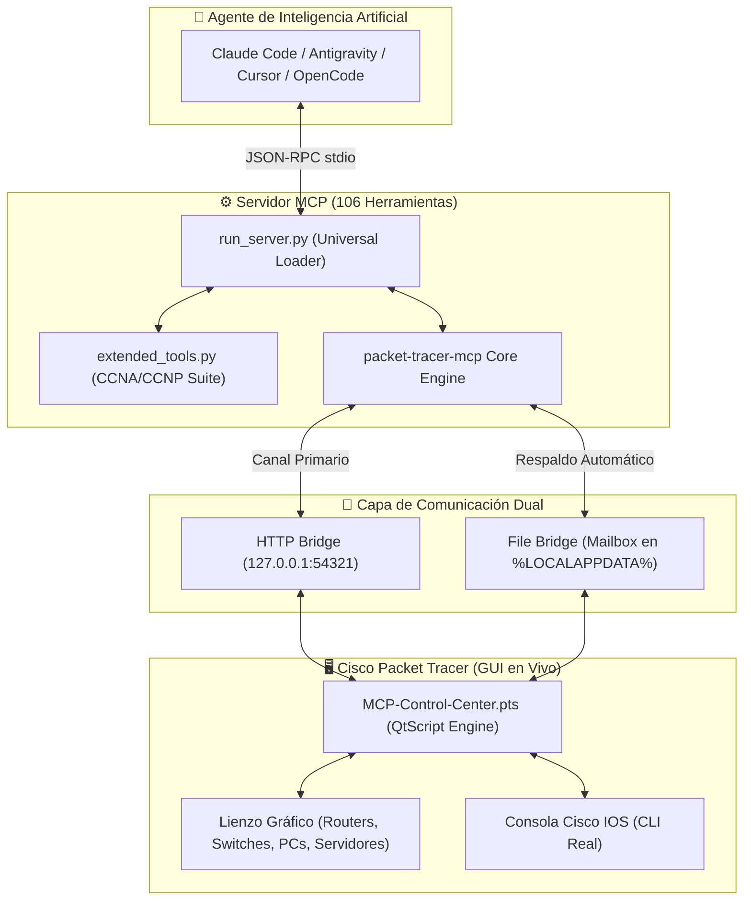

# 🌐 Agent MCP - Cisco Packet Tracer (Real-Time Live Automation)

[](https://www.python.org/downloads/)
[](https://modelcontextprotocol.io/)
[](https://www.netacad.com/courses/packet-tracer)
[]()
[]()

> ### 🎖️ Autoría y Marca de Agua Oficial
> **Este proyecto fue concebido, diseñado y programado por:**  
> **Ingeniero en Informática Helton Smith Bustos Sáez**  
> *Magíster en Full Stack | Experto en Ciberseguridad e Inteligencia Artificial Aplicada*

---

## 📖 Visión General del Proyecto

**Agent MCP - Cisco Packet Tracer** es una suite de orquestación de redes en tiempo real que dota a cualquier Agente de Inteligencia Artificial (**Antigravity IDE**, **Antigravity CLI**, **Claude Code**, **Cursor**, **OpenCode**, **VS Code Copilot**, **Claude Desktop**) de la capacidad de crear, conectar, configurar y diagnosticar topologías completas de red **en vivo y directamente sobre la pantalla de Cisco Packet Tracer**.

A diferencia de los emuladores virtuales en memoria, esta solución se acopla al **Script Engine (QtScript)** original de Cisco Packet Tracer mediante una extensión especializada (`.pts`) y un sistema de transporte dual (**HTTP Bridge :54321** + **File Bridge de alta disponibilidad**).

---

## 🏛️ Diagrama de Arquitectura



---

## 🎛️ Catálogo Maestro de Hardware Soportado (100% Packet Tracer)

### 1. Routers Cisco ISR / Edge
| Modelo | Categoría | Interfaces Nativas | Ranuras de Expansión |
| :--- | :--- | :--- | :--- |
| **Cisco 2911** | Router ISR G2 | 3x GigabitEthernet (0/0, 0/1, 0/2) | 3x HWIC (HWIC-2T para seriales) |
| **Cisco 1941** | Router ISR G2 | 2x GigabitEthernet (0/0, 0/1) | 2x HWIC (HWIC-2T) |
| **Cisco 2901** | Router ISR G2 | 2x GigabitEthernet (0/0, 0/1) | 4x HWIC |
| **Cisco 2811** | Router Clásico | 2x FastEthernet (0/0, 0/1) | 4x WIC, 1x NM (VoIP CME ready) |
| **ISR 4331 / 4321**| Router ISR 4K | 3x GigabitEthernet (0/0/0 a 0/0/2) | Ranuras NIM |
| **Cisco 1841** | Router Modular | 2x FastEthernet | Ranuras WIC |
| **819HG-4G / 829** | Router Industrial | GigabitEthernet + Cellular 4G | IoT / Transporte |
| **CGR1240** | Grid Router | Interfaces industriales IoT | Subestaciones |

### 2. Switches Catalyst Cisco
| Modelo | Tipo | Puertos | Capacidad |
| :--- | :--- | :--- | :--- |
| **Catalyst 2960-24TT** | Capa 2 (L2) | 24x FastEthernet (0/1-24) + 2x GigE (0/1-2) | VLANs, STP, Trunking, Port Security |
| **Catalyst 3560-24PS** | Multicapa (L3) | 24x FastEthernet PoE + 2x GigE SFP | Enrutamiento Inter-VLAN SVI, PoE |
| **Catalyst 3650-24PS** | Multicapa (L3) | 24x GigabitEthernet PoE + 4x SFP+ | Enrutamiento IP Empresarial, OSPF |
| **Catalyst 2950-24** | Capa 2 (L2) | 24x FastEthernet | Switch estándar CCNA |
| **IE-2000** | Industrial (L2) | Puertos blindados para fábricas | IoT / Industrial Ethernet |

### 3. Seguridad y Firewalls
| Modelo / Función | Descripción |
| :--- | :--- |
| **Cisco ASA 5506-X** | Firewall de Próxima Generación (8x GigabitEthernet) con FirePOWER. |
| **Cisco ASA 5505** | Firewall perimetral clásico con 8 puertos FastEthernet. |
| **Listas de Acceso (ACLs)** | Estándar (1-99), Extendidas (100-199) y Nombradas IPv4/IPv6. |
| **NAT / PAT** | NAT Estático, Pool Dinámico y NAT Overload (PAT). |
| **Device Hardening** | Port Security, SSH v2, AAA, contraseñas cifradas y timeouts. |

### 4. Redes Inalámbricas (Wi-Fi)
| Dispositivo | Rol en la Red |
| :--- | :--- |
| **WLC-PT** | Wireless LAN Controller (controlador centralizado de APs ligeros). |
| **LAP-PT** | Lightweight Access Point (gestionado por el WLC mediante CAPWAP). |
| **Cisco 3702i** | Access Point Empresarial Autónomo Dual-Band 802.11ac. |
| **HomeRouter-PT-AC** | Router inalámbrico doméstico con Wi-Fi, DHCP y NAT integrados. |
| **Linksys-WRT300N** | Router inalámbrico residencial clásico. |

### 5. Servidores y Endpoints
- **Server-PT:** Soporta servicios simultáneos de **DNS**, **Web HTTP/HTTPS**, **DHCP**, **FTP**, **Email (SMTP/POP3)**, **Syslog**, **NTP**, **AAA (RADIUS/TACACS+)** e **IoT Server**.
- **PC-PT y Laptop-PT:** Terminales cliente con soporte Ethernet por cable o tarjeta inalámbrica Wi-Fi.
- **Cisco IP Phone 7960:** Teléfonos VoIP con soporte de pantalla, PoE y registro en Cisco Unified CallManager Express (CME).
- **Printers, Tablets y Smartphones.**
- **IoT & Industrial:** Microcontroladores **MCU-PT**, computadoras de placa única **SBC-PT** (Raspberry Pi) y actuadores inteligentes (luces, puertas, ventiladores, sirenas, sensores).

### 6. Tipos de Cableado
- `straight` (Cable de par trenzado directo)
- `cross` (Cable de par trenzado cruzado)
- `serial` (Cable Serial WAN DTE / DCE con sincronización de Clock Rate)
- `fiber` (Fibra óptica monomodo / multimodo)
- `console` (Cable de consola para administración fuera de banda)
- `coaxial` (Cable coaxial para enlaces de TV / Cable Módem)
- `auto` (Detección automática de medio con Auto-MDIX)

---

## ⚡ Matriz de Protocolos y Servicios

| Área | Protocolos Soportados | Herramientas MCP Clave |
| :--- | :--- | :--- |
| **Enrutamiento Dinámico (L3)** | RIPv1, RIPv2, RIPng, OSPFv2, OSPFv3 (Single & Multi-Area), EIGRP con AS, BGP (eBGP/iBGP), Rutas Estáticas y Flotantes. | `pt_configure_rip`, `pt_configure_eigrp`, `pt_apply_bgp`, `pt_configure_static_route`, `pt_read_routes`, `pt_read_ospf` |
| **Switching y Conmutación (L2)** | VLANs 802.1Q, Inter-VLAN Router-on-a-Stick, SVIs en Switch L3, Spanning-Tree (PVST, Rapid-PVST, MST), EtherChannel (LACP, PAgP). | `pt_apply_vlan`, `pt_configure_router_on_a_stick`, `pt_configure_spanning_tree`, `pt_configure_etherchannel_bundle`, `pt_read_vlans`, `pt_read_stp` |
| **Seguridad Perimetral** | Port-Security (sticky MAC, violation restrict/shutdown), ACLs Estándar y Extendidas, NAT Overload (PAT), Hardening IOS. | `pt_apply_port_security`, `pt_apply_acl`, `pt_apply_nat`, `pt_apply_hardening`, `pt_audit_security` |
| **Servicios de Red** | Servidor DHCP en IOS, Servidor DNS en Server-PT, Servidor Web HTTP/HTTPS, Syslog, NTP, Redundancia Gateway HSRP. | `pt_configure_ios_dhcp_server`, `pt_configure_dns_records`, `pt_configure_web_server`, `pt_apply_hsrp`, `pt_apply_netflow` |
| **Voz sobre IP & QoS** | Cisco CallManager Express (CME), ephones, ephone-dn, DHCP option 150, QoS MQC (class-map, policy-map, LLQ). | `pt_apply_voice`, `pt_apply_qos`, `pt_read_qos` |
| **Diagnóstico & Pruebas** | Ping de extremo a extremo, traza PDU capa por capa, Fast Forward del reloj para convergencia instantánea. | `pt_verify_connectivity`, `pt_fast_forward`, `pt_send_pdu`, `pt_health_check`, `pt_inspect_ports` |

---

## 🚀 Guía de Puesta en Marcha en 4 Pasos

### Paso 1: Instalar Dependencias
En la carpeta del proyecto ejecuta:
```bash
pip install -r requirements.txt
```
*(En Windows puedes simplemente hacer doble clic en `install.bat`).*

### Paso 2: Cargar el Módulo en Cisco Packet Tracer
1. Abre tu **Cisco Packet Tracer**.
2. Ve a: **`Extensions` ➡️ `Scripting` ➡️ `Configure PT Script Modules...`**
3. Haz clic en **`Add...`** y selecciona el archivo `MCP-Control-Center.pts` incluido en el repositorio.
4. Presiona **`Yes`** en el cuadro de confirmación.
5. Se abrirá la ventana **`MCP Control Center`** (puedes dejarla abierta o minimizarla).

### Paso 3: Configurar tu Agente de IA

El lanzador universal es **`run_server.py`**. Copia el bloque según tu editor:

#### 🔹 Antigravity IDE / Antigravity CLI
Edita tu `mcp_config.json`:
```json
{
  "mcpServers": {
    "cisco-packet-tracer": {
      "command": "python",
      "args": [
        "run_server.py"
      ],
      "env": {
        "PYTHONUNBUFFERED": "1"
      }
    }
  }
}
```

#### 🔹 Claude Code (Terminal CLI)
```bash
claude mcp add --scope user --transport stdio cisco-packet-tracer -- python run_server.py
```

#### 🔹 Cursor IDE
En `Cursor Settings -> Features -> MCP Servers`:
- Command: `python run_server.py`

#### 🔹 Claude Desktop
En tu archivo de configuración de Claude Desktop:
```json
{
  "mcpServers": {
    "cisco-packet-tracer": {
      "command": "python",
      "args": ["C:\\Ruta\\run_server.py"]
    }
  }
}
```

### Paso 4: ¡Comienza a Crear en Lenguaje Natural!
Dile a tu agente lo que deseas construir. Por ejemplo:
```text
"Crea una topología de 2 routers 2911 conectados por Serial con tarjetas HWIC-2T. Añade una PC a cada router, configura direccionamiento IP y enrútalos con RIPv2 con verificación de ping."
```

---

## 💻 Panel Web Interactivo (`index.html`)

Para una experiencia guiada con diseño futurista estilo Cisco / Tailwind CSS:
- Abre **`index.html`** con doble clic en tu navegador.
- Incluye pestañas interactivas, generador de snippets de configuración, matriz de hardware filtrable y biblioteca de laboratorios preconstruidos.

---

## 👤 Créditos y Firma de Autoría

```text
====================================================================================================
PROYECTO: Agent MCP - Cisco Packet Tracer
AUTOR:    Ingeniero en Informática Helton Smith Bustos Sáez
GRADO:    Magíster en Full Stack
ÁREAS:    Experto en Ciberseguridad e Inteligencia Artificial Aplicada
LICENCIA: Open Source bajo estándar MIT
AÑO:      2026
====================================================================================================
```
